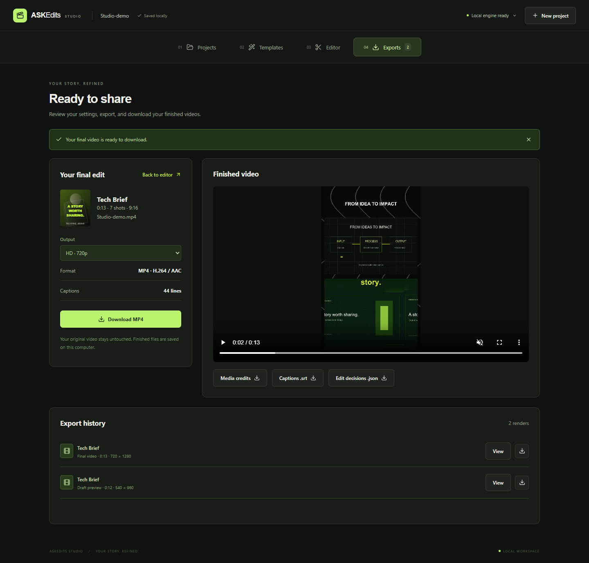
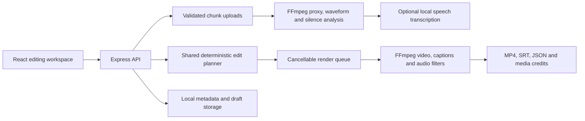

# ASKEdits Studio

A local video editing studio: upload footage, choose a template, refine the timeline, and export a finished MP4. React handles the workspace; Express, FFmpeg, and optional local Faster-Whisper perform the media work.


## From footage to finished edit

The workspace has four separate pages, with one task per page:

| Page                         | What you do                                                                                                                                         |
| ---------------------------- | --------------------------------------------------------------------------------------------------------------------------------------------------- |
| **Projects** · `/projects`   | Upload footage, try the narrated demo, or reopen a saved project.                                                                                   |
| **Templates** · `/templates` | Browse 13 editing recipes and choose a style.                                                                                                |
| **Editor** · `/editor`       | Refine the timeline and captions, then render a short 540p preview. Framing, pacing, captions, visuals, and audio each have their own settings tab. |
| **Exports** · `/exports`     | Review the edit, choose 720p or 1080p, and download MP4, SRT, JSON, and media credits. Revisit earlier renders.                                     |

Navigation preserves the current edit and background renders. Project links include a project identifier, so refresh and browser Back/Forward restore the correct workspace. You can choose a template before uploading footage. The studio builds a shot plan and retimes captions around the cuts.

| Template          | Editing recipe                                                                                          |
| ----------------- | ------------------------------------------------------------------------------------------------------- |
| Tech Brief        | Presenter panel, supporting footage, animated section cards, lime word captions, original sound effects |
| Creator Punch     | Pause removal, bold captions, alternating punch-ins, vertical framing                                   |
| Cinematic Story   | Distributed montage shots, dissolves, gentle movement, filmic color, music                              |
| Podcast Spotlight | Short speech excerpt, pause removal, clean captions, subtle reframing                                   |
| Clean Interview   | Natural color, restrained captions, optional motion, tighter pauses                                     |
| Product Launch    | Short shots, crisp color, square framing, rhythmic music                                                |
| Travel Journal    | Warm color, relaxed movement, soft transitions, vertical framing                                        |
| Documentary Explainer | Wide presenter, restrained chapter graphics, cinematic music, gentle pace |
| Startup Pitch | Portrait presenter, kinetic captions, brisk pace, supporting footage and a pulse bed |
| Tutorial Walkthrough | Longer wide shots, clean subtitles, preserved demonstrations and natural color |
| News Update | Concise portrait briefing, bold captions, chapter graphics and subtle sound cues |
| Fitness Reel | Fast portrait montage, stronger contrast, quick slides and energetic music |
| Food & Lifestyle | Warm 4:5 framing, longer close-ups, soft dissolves and relaxed music |

Every recipe is adjustable. Use blurred fit or a crop with a manual focal point; choose vertical, landscape, square, or portrait output. Edit caption text and source timestamps, import SRT, and choose four caption styles. Audio controls include speech cleanup, source level, three original generated music beds, custom audio upload, and automatic music ducking under speech.

Drafts, original footage, and export history are stored locally. Reopen recent projects, retry preparation, and cancel queued or active renders. The timeline displays actual shot decisions, caption timing, and source audio peaks.

## Reference-inspired explainer editing

**Tech Brief** takes its visual direction from the [reference Short](https://youtube.com/shorts/JlMzLG-ZFwk): a presenter below supporting visuals, bold lime word captions, numbered sections, and animated contour graphics. See [the implementation notes](docs/reference-style.md) for the observed details and limits.

Choose **Tech Brief → Editor → Visuals → Build reference sequence**. The corrected layout keeps the presenter large and creates topic cards across the full edit, rather than leaving the visual panel empty after the opening. Chapter titles are editable. Upload video or images, or click **Try original motion sample**, then adjust each placement on the edited timeline. B-roll audio is muted so narration continues. The library supports 24 assets per project (80 MB each), with up to 12 placements. Set a video source in-point, label each visual, or use auto-place to spread clips across the edit. Images fit inside the visual panel; videos fill it.

Choose cuts, dissolves, slides, wipes, or flashes in Pacing. Set headline and animated graphics in Visuals, word captions in Captions, and original synthesized whoosh/impact/click cues in Audio. Preview and final export use the same plan. Exports include a poster and media credits.



Use **Editor → Visuals → Find & add internet B-roll** to download up to four relevant videos and enable caption-timed placement. Downloads run in the background with progress and cancellation; partial files are removed, completed imports survive navigation/restarts, and repeated runs avoid duplicate source URLs. Your uploaded video stays local. Searches send topic keywords to the selected provider.

The default no-key option is a small, curated collection of ten [Mixkit](https://mixkit.co/free-stock-video/) clips covering coding, business, education, travel, fitness and food. The server rechecks each clip's current [Free Video License](https://mixkit.co/license/#videoFree) before downloading; unavailable or restricted clips are skipped. This is not full-library Mixkit search. Live metadata and media availability were checked, and real clips were downloaded and imported on Windows. Raw stock media is kept in ignored local storage and is not redistributed in this repository.

For wider searches, select Wikimedia Commons (no key) or Pexels (server-side PEXELS_API_KEY and restart). Wikimedia DNS is unavailable on this development computer; its provider errors are shown and other providers work independently. Pexels access requires your own API key. Manual stock search/import remains available. Imported files retain source and license metadata in the export credits. Downloads require internet access and are limited to approved HTTPS hosts, 80 MB per clip and 24 library assets per project.

For a cutout presenter over the graphics, set PYTHON_BIN and run **npm run setup:visuals**, then restart the server and enable **Remove presenter background**. This installs MediaPipe locally and a checksum-verified Google selfie model; footage stays on your computer. The first render prepares a reusable person mask. If your source already has burned captions, enable **Crop existing source captions** and adjust its top/bottom crop while reviewing framing. Cropping removes that part of the image; it does not reconstruct what was underneath.

This preset does not extract another video's footage or soundtrack. Topic cards use transcript keyword heuristics and can be edited. It does not infer arbitrary video styles from a URL.

## Caption-directed footage and transitions

Choose **Editor → Visuals → Sync edit to captions**. The planner follows timed phrases and sentence boundaries, ranks your library clips by their names and descriptions, and inserts relevant footage at the spoken match. Clip order in the library does not decide the sequence. Narration cuts follow phrase boundaries; video entries use slides, stills use dissolves, and related visual entries use clean cuts. Speech stays continuous across those visual transitions.

Describe each asset in **What is in this clip?**. Descriptions save when the field loses focus. Caption, trim and description changes recompute the decisions. The expandable decision list shows the quoted phrase, selected media, entry time, transition, and reason. **Keep these choices and edit manually** freezes the current placements for adjustment.

Run **npm run setup:matcher**, then restart, to enable the local MiniLM sentence model. It downloads a fixed model revision into ignored storage/models/; inference makes no network requests and no transcript or footage is uploaded. Without the model, the app explicitly uses keyword matching. This computer has the sentence model installed.

If no clip is relevant, the planner keeps the presenter/topic graphic and offers **Find stock for this phrase** with a suggested query. The internet B-roll action searches distinct spoken topics, ranks descriptions locally, downloads matching videos, and replans timing. Curated stock may illustrate a general topic rather than the exact named product or person; those decisions are labelled as illustrative stock. Review the preview and freeze the choices for manual adjustments. Without captions, the download job asks you to transcribe or import SRT first.

Matching uses media descriptions, not visual inspection of its frames. Accurate captions and descriptions matter. English is the model's primary language. Imported multiword SRT phrases use estimated word positions; recognized word timings provide more precise synchronization. Automatically selected video snippets begin at their source start and do not loop beyond the clip's available duration. Freeze the choices to pick a different source in-point.

## Run locally

Requires Node.js **22.12+** and **FFmpeg 8+** with ffprobe, H.264/AAC encoders, and the ASS subtitle filter. FFmpeg 8 was tested on Windows; CI uses the [BtbN 8.1 Linux build](https://github.com/BtbN/FFmpeg-Builds/releases/tag/latest) with checksum verification. Install fonts with coverage for your caption language.

```sh
npm ci
```

Copy .env.example to .env. Set FFMPEG_BIN and FFPROBE_BIN if they are not on PATH. Then:

```sh
npm run build
npm start
```

Open **http://127.0.0.1:8787**. No API key is required for the template editor, rendering, or manual captions. The included demo contains original graphics and synthetic narration so you can try the entire workflow.

For automatic captions, install Python 3.11+ and the optional speech dependency:

```sh
python -m pip install -r python/requirements.txt
```

Set PYTHON_BIN to that interpreter. The default tiny model downloads on first transcription; larger Faster-Whisper models trade speed and memory for accuracy. Select the source language or automatic detection before upload. Captions remain editable, and an unavailable model never prevents template editing or SRT import. Core editing and local transcription do not send footage to a cloud AI service.

For development, npm run dev starts Vite and the API and chooses available ports. Media and generated files live under the ignored storage/ directory; keep that directory when moving an installation.

## Engineering



- Shared browser/server validation and chunk transport for files up to 2 GB.
- A deterministic planner maps source timestamps into output timestamps after trims, pause cuts, and transitions. Preview shots match the beginning of the final edit.
- Real render progress, bounded process output, cancellation signals, partial-output cleanup, and restart recovery messages.
- Per-asset serialized metadata updates and atomic replacement with bounded retries for Windows file locks.
- Validated asset identifiers, generated artifact paths, audio stream inspection, and server-side credentials.
- Accessible controls, keyboard focus, reduced motion, and a responsive workspace.

The shared workspace state lives in src/frontend/Studio.jsx. ProjectsPage, TemplatesPage, EditorPage, and ExportsPage render the separate screens; StudioContext shares the active edit between them. Templates and planning live in src/shared/; the render engine is src/backend/services/template-renderer.js. Earlier experimental AI and vision modules remain separate from the template workflow. Design plans in docs/phases/ are historical, not a completed feature checklist.

## Verify

```sh
npm test
npm run build
npm run test:media
npx playwright install chromium
npm run test:ui
```

Media tests require FFmpeg/ffprobe. Browser checks start their own server and temporary storage, render a preview and final video, and check downloads, saved settings, and mobile layout. Set PLAYWRIGHT_CHROMIUM_EXECUTABLE to use an installed Chrome. See [VALIDATION.md](VALIDATION.md) for verified results.

## Scope

This is a single-user local application. Keep the loopback binding; public hosting requires authentication, tenant isolation, and a durable job service. Templates make reproducible editing decisions rather than judging a story like a human editor. Excerpt suggestions use transcript heuristics, or evenly spaced positions when speech is unavailable. Cropping uses your chosen focal point. Transcript quality depends on the model and recording; review captions and framing before publishing. Rendering uses CPU H.264; long or high-resolution footage needs more time and disk space.
