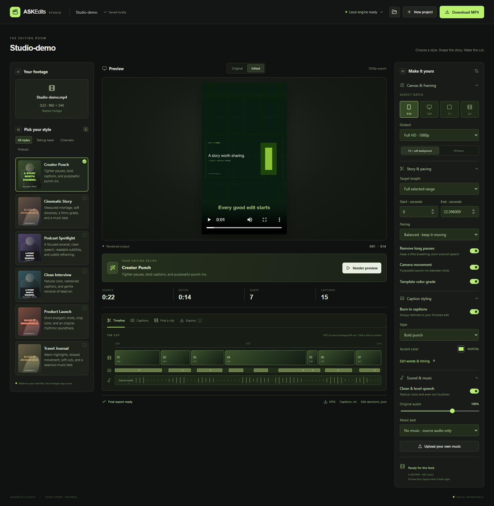
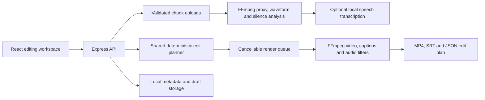

# ASKEdits Studio

A local video editing studio: upload footage, choose a template, refine the timeline, and export a finished MP4. React handles the workspace; Express, FFmpeg, and optional local Faster-Whisper perform the media work.



## From footage to finished edit

1. Upload MP4, MOV, WebM, or MKV footage, or select **Try demo footage**.
2. Choose a template. The studio builds a shot plan and retimes captions around the cuts.
3. Adjust the excerpt, pacing, framing, captions, color, and music. Inspect the timeline or compare the source with an edited preview.
4. Render a short 540p preview, then export at 720p or 1080p. Download the MP4, timed SRT captions, and JSON edit plan.

| Template          | Editing recipe                                                             |
| ----------------- | -------------------------------------------------------------------------- |
| Creator Punch     | Pause removal, bold captions, alternating punch-ins, vertical framing      |
| Cinematic Story   | Distributed montage shots, dissolves, gentle movement, filmic color, music |
| Podcast Spotlight | Short speech excerpt, pause removal, clean captions, subtle reframing      |
| Clean Interview   | Natural color, restrained captions, optional motion, tighter pauses        |
| Product Launch    | Short shots, crisp color, square framing, rhythmic music                   |
| Travel Journal    | Warm color, relaxed movement, soft transitions, vertical framing           |

Every recipe is adjustable. Use blurred fit or a crop with a manual focal point; choose vertical, landscape, square, or portrait output. Edit caption text and source timestamps, import SRT, and choose three caption styles. Audio controls include speech cleanup, source level, three original generated music beds, custom audio upload, and automatic music ducking under speech.

Drafts, original footage, and export history are stored locally. Reopen recent projects, retry preparation, and cancel queued or active renders. The timeline displays actual shot decisions, caption timing, and source audio peaks.

## Run locally

Requires Node.js **22.12+** and FFmpeg with ffprobe, H.264/AAC encoders, and the ASS subtitle filter. FFmpeg 8 was tested on Windows; CI also exercises the Linux distribution build. Install fonts with coverage for your caption language.

```sh
npm ci
```

Copy .env.example to .env. Set FFMPEG_BIN and FFPROBE_BIN if they are not on PATH. Then:

```sh
npm run build
npm start
```

Open **http://127.0.0.1:8787**. No API key is required for the template editor, rendering, or manual captions. The included demo contains original graphics and synthetic narration so you can try the entire workflow.

For automatic captions, install Python 3.11+ and the optional speech dependency:

```sh
python -m pip install -r python/requirements.txt
```

Set PYTHON_BIN to that interpreter. The default tiny model downloads on first transcription; larger Faster-Whisper models trade speed and memory for accuracy. Select the source language or automatic detection before upload. Captions remain editable, and an unavailable model never prevents template editing or SRT import. Core editing and local transcription do not send footage to a cloud AI service.

For development, npm run dev starts Vite and the API and chooses available ports. Media and generated files live under the ignored storage/ directory; keep that directory when moving an installation.

## Engineering



- Shared browser/server validation and chunk transport for files up to 2 GB.
- A deterministic planner maps source timestamps into output timestamps after trims, pause cuts, and transitions. Preview shots match the beginning of the final edit.
- Real render progress, bounded process output, cancellation signals, partial-output cleanup, and restart recovery messages.
- Per-asset serialized metadata updates and atomic replacement with bounded retries for Windows file locks.
- Validated asset identifiers, generated artifact paths, audio stream inspection, and server-side credentials.
- Accessible controls, keyboard focus, reduced motion, and a responsive workspace.

The active editor is src/frontend/Studio.jsx; templates and planning live in src/shared/; the render engine is src/backend/services/template-renderer.js. Earlier experimental AI and vision modules remain separate from the template workflow. Design plans in docs/phases/ are historical, not a completed feature checklist.

## Verify

```sh
npm test
npm run build
npm run test:media
npx playwright install chromium
npm run test:ui
```

Media tests require FFmpeg/ffprobe. Browser checks start their own server and temporary storage, render a preview and final video, and check downloads, saved settings, and mobile layout. Set PLAYWRIGHT_CHROMIUM_EXECUTABLE to use an installed Chrome. See [VALIDATION.md](VALIDATION.md) for verified results.

## Scope

This is a single-user local application. Keep the loopback binding; public hosting requires authentication, tenant isolation, and a durable job service. Templates make reproducible editing decisions rather than judging a story like a human editor. Excerpt suggestions use transcript heuristics, or evenly spaced positions when speech is unavailable. Cropping uses your chosen focal point. Transcript quality depends on the model and recording; review captions and framing before publishing. Rendering uses CPU H.264; long or high-resolution footage needs more time and disk space.
